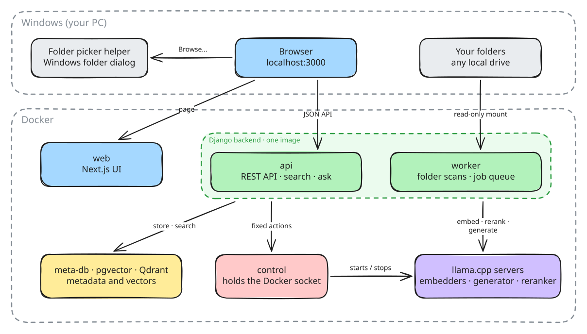

# RAG Studio

A local workbench for retrieval-augmented generation (RAG) on Windows. Point it at folders on your PC, build vector
databases from them, then search them and ask questions answered only from your own files, with citations. Every stage
of the pipeline is visible, every concept on screen opens a short explanation, and nothing leaves your machine.


## How RAG helps to answer a question


## What it demonstrates

| Stage | How RAG Studio does it |
|---|---|
| Ingestion | Watches folders and re-embeds only changed files. Token-aware chunking with overlap; Markdown splits along headings. |
| Embedding | Local embedding models served by llama.cpp, on CPU or GPU. |
| Storage | Two vector engines behind one interface: pgvector and Qdrant. |
| Retrieval | Vector, keyword (BM25) and hybrid search, fused with Reciprocal Rank Fusion (RRF). |
| Reranking | A cross-encoder re-scores a larger candidate pool. |
| Generation | Numbered passages fitted to the model's context window, cited answers, optional thinking mode, speed timings. |
| Operations | One-at-a-time job queue, VRAM guard before every GPU start, optional GPU, least-privilege Docker control. |

## Learn RAG

`RAGStudioVault/` is an [Obsidian](https://obsidian.md) vault of about 110 short notes:
- **Concept notes** for Ingestion, Storage, Search, Answering and Runtime. Every dotted-underlined label in the UI opens
  one.
- **[`RagStudio/`](RAGStudioVault/RagStudio/RagStudio.md)**: the app itself, written as a specification with no
  implementation detail.

## Behavior

How every feature behaves, including its edge cases, is in the vault:
- [Features](RAGStudioVault/RagStudio/Features/Features.md): sources, databases, search, ask, models, the GPU memory
  guard, the activity log.
- [Lifecycle](RAGStudioVault/RagStudio/Lifecycle/Lifecycle.md): starting, shutting down, what is kept.
- [Design](RAGStudioVault/RagStudio/Design/Design.md): local and private, least privilege, one job at a time.

## Requirements

Windows 10 22H2 or Windows 11, 64-bit, with virtualization enabled. Everything else runs in Docker.

| Requirement | Notes |
|---|---|
| WSL 2 | `wsl --install` |
| Docker Desktop, WSL 2 backend | `start.ps1` starts it when needed |
| PowerShell 7 | Runs `start.ps1` |
| NVIDIA GPU and driver | Optional. Without one, models run on the CPU, much slower. Model lists are sized for 12 GB VRAM |
| `uv` | Optional. Runs the **Browse…** folder dialog; without it, type folder paths |
| Chrome, Obsidian | Optional. Chrome opens the UI (otherwise the default browser); Obsidian opens notes from the popups |

- **Hardware:** 16 GB RAM (32 GB for the largest generator); about 10 GB of disk for images, plus 0.15–16 GB per model.
- **Free local ports:** 3000, 8000, 8010, 5434.
- **Internet:** for the first build and model downloads only. No accounts.

```powershell
wsl --install                                                          # elevated prompt, then restart
choco install docker-desktop powershell-core uv googlechrome obsidian  # elevated prompt
```

## Running

1. Open Docker Desktop once and accept its terms.
2. Run `.\start.ps1`. The first run builds the images (several minutes), then opens http://localhost:3000.
3. Stop with the UI's **Shut down** button. Databases, models and settings are kept.

```powershell
.\start.ps1 --build      # rebuild after code changes
.\start.ps1 --no-build   # start from existing images
.\start.ps1 --default    # system default browser instead of Chrome
```

If PowerShell blocks the script: `Set-ExecutionPolicy -Scope CurrentUser RemoteSigned`. A ZIP download also needs
`Get-ChildItem -Recurse | Unblock-File`.

## Architecture



| Service | Role |
|---|---|
| `web` | Next.js UI |
| `api` | Django Ninja API, http://localhost:8000/api |
| `worker` | Scans sources and runs jobs one at a time; reads every drive read-only at `/host/<drive letter>` |
| `control` | The only service with the Docker socket; starts and stops model servers |
| `meta-db` | App metadata: sources, databases, jobs, logs |
| `pgvector`, `qdrant` | Vector engines; each app database is `vdb_<id>` |
| `embed-…`, `generator`, `reranker` | llama.cpp model servers, started on demand |

## Development

Needs `uv` and Node.js 24 (`npm ci` in `web/`).

```powershell
uv --directory backend run pytest
uv run --no-project --with pytest --directory control pytest
uv run --no-project --with pytest --directory folder-picker pytest -p no:cacheprovider
npm --prefix web test
uvx ruff check .; uvx ruff format --check .
npm --prefix web run lint; npm --prefix web run typecheck
```

| Area | Code |
|---|---|
| Sources and host paths | `backend/studio/sources/` |
| Sync, chunking, embedding | `backend/studio/ingestion/` |
| Vector engines (implement `VectorEngine`) | `backend/studio/databases/engines/` |
| Search, ask, context budget | `backend/studio/search/` |
| Model catalogs, model servers, VRAM check | `backend/studio/inference/` |
| Jobs and progress | `backend/studio/jobs/` |
| Request guards | `backend/studio/origin_guard.py`, `ALLOWED_HOSTS` in `backend/studio_site/settings.py` |
| Docker actions, llama.cpp version | `control/control_actions.py` |
| Folder dialog helper | `folder-picker/folder_picker.py` |
| UI | `web/components/` |

- `docker compose -f compose.yaml -f compose.gpu.yaml up -d --build` starts the stack by hand; drop `compose.gpu.yaml`
  without an NVIDIA GPU.
- Change `LLAMA_CPP_BUILD` only after starting an embedder, the generator and the reranker on the new build.
- After moving this folder, run `uv sync --reinstall` in `backend/`.
- The database passwords in `compose.yaml` are local on purpose: every published port binds to `127.0.0.1`.

## License

MIT. See `LICENSE`. Models are not part of this repository: each is downloaded from Hugging Face under its own licence
(for example, Gemma models under the Gemma Terms of Use).
